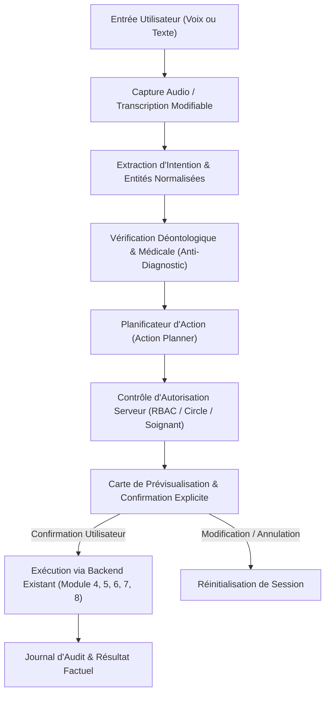

# MauriCare Voice AI — Architecture & Spécifications Techniques

## 1. Vision Produit & Principe Fondateur
**MauriCare Voice AI** est une interface d'orchestration conversationnelle (vocale et textuelle) conçue pour permettre aux patients, aux proches aidants (MauriCare Circle) et aux professionnels de santé d'interagir naturellement avec l'écosystème MauriCare.

> [!IMPORTANT]
> **Règle Fondamentale « Zéro IA Diagnostique »**
> Voice AI n'est en aucun cas un outil de diagnostic médical, d'interprétation biologique ou de prescription thérapeutique. L'IA agit exclusivement comme une interface d'orchestration et de commande : elle extrait des intentions structurées et prépare des actions pour le backend MauriCare, qui demeure la seule autorité d'autorisation et d'exécution.

---

## 2. Pipeline Canonique d'Exécution
L'intelligence artificielle n'a aucun accès direct en écriture à la base de données. Toute commande transite obligatoirement par le pipeline suivant :

---

## 3. Abstraction des Fournisseurs (Provider Abstraction)

Pour éviter tout verrouillage propriétaire et garantir la souveraineté des données médicales, le système s'articule autour de trois abstractions modulaires :

### A. `SpeechToTextProvider`
- **Implémentation par défaut** : `WebSpeechSTTProvider`
  - Utilise l'API Web Speech native du navigateur (`SpeechRecognition` / `webkitSpeechRecognition`).
  - **Engagement MauriCare** : MauriCare n'enregistre ni ne stocke aucun flux audio sur ses serveurs applicatifs.
  - **Comportement du navigateur** : Le traitement de la parole dépend du moteur vocal du navigateur/OS de l'utilisateur (pouvant utiliser les services vocaux natifs du système).
  - Un repli textuel complet est disponible en permanence pour garantir la confidentialité et l'accessibilité.
  - Support du Français (`fr-FR`) et de l'Arabe standard (`ar-SA`, `ar-MA`).
- **Extensibilité** : Interface prête pour connecteur Whisper/Cloud privé si requis en production.

### B. `IntentProvider`
- **Implémentation par défaut** : Moteur hybride déterministe & sémantique
  - Étage 1 : Parseur déterministe d'intentions médicales et temporelles (dates relatives, spécialités soignantes, constantes physiologiques, bénéficiaires du Cercle).
  - Étage 2 : Connecteur pour modèle LLM via `@vly-ai/integrations` (ou OpenAI compatible côté serveur) sans jamais transmettre le dossier médical complet.
  - Traitement strict des entrées comme non sécurisées (résistance aux injections de prompt).

### C. `TextToSpeechProvider`
- **Implémentation par défaut** : `WebSpeechTTSProvider`
  - Utilise l'API native `window.speechSynthesis`.
  - La réponse textuelle écrite à l'écran reste **toujours** visible et prioritaire.
  - La synthèse vocale est activable/désactivable par l'utilisateur.

---

## 4. Sécurité des Clés & Confidentialité

1. **Secrets Serveur Uniquement** :
   - Aucune clé d'API AI n'est exposée côté client Vite.
   - Les appels externes sont exécutés exclusivement via les actions backend Convex sécurisées.
2. **Minimisation des Données Médicales** :
   - Seul le texte transcrit de la commande actuelle est transmis pour extraction d'intention.
   - Le dossier médical, les pièces d'identité, les comptes-rendus de laboratoire et les messages Relay ne sont **jamais** envoyés au modèle externe.
3. **Protection Audio** :
   - Aucun flux vocal brut n'est archivé. La reconnaissance s'exécute de façon éphémère.
4. **Étanchéité des Permissions** :
   - **MauriCare Circle** : L'IA ne peut pas contourner les habilitations accordées (`BOOK_APPOINTMENTS`, `MANAGE_HOMELAB`, `VIEW_SELECTED_HEALTH_DATA`).
   - **MauriCare Relay** : Seul un professionnel accrédité avec relation de soin confirmée peut initier une demande d'avis.
   - **MauriCare HomeLab** : La commande par un proche exige formellement `MANAGE_HOMELAB`.

---

## 5. Matrice des Intentions Canoniques (Allowlist)

| Intention | Rôle Autorisé | Action Requise | Politique de Confirmation |
|---|---|---|---|
| `BOOK_APPOINTMENT` | Patient, Cercle | Réservation de soin | **Confirmation obligatoire** (Carte détaillée) |
| `REBOOK_APPOINTMENT` | Patient, Cercle | Réitération de soin antérieur | **Confirmation obligatoire** |
| `CANCEL_APPOINTMENT` | Patient, Cercle, Soignant | Annulation de rendez-vous | **Confirmation obligatoire** |
| `VIEW_UPCOMING_APPOINTMENTS` | Tous rôles | Consultation planning | Exécution directe (Lecture seule) |
| `VIEW_PROVIDER_AVAILABILITY` | Patient, Cercle | Disponibilités d'un soignant | Exécution directe (Lecture seule) |
| `VIEW_HOMELAB_STATUS` | Patient, Cercle | État logistique des analyses | Exécution directe (Lecture seule) |
| `VIEW_HOMELAB_RESULT` | Patient, Cercle autorisé | Consultation compte-rendu | Exécution directe avec contrôle d'accès |
| `CREATE_HOMELAB_REQUEST` | Patient, Cercle (`MANAGE_HOMELAB`) | Commande prélèvement | **Confirmation obligatoire** |
| `RECORD_HEALTH_MEASUREMENT` | Patient, Soignant | Relevé de constantes | **Confirmation obligatoire** (Valeurs + Date) |
| `VIEW_HEALTH_TREND` | Patient, Soignant, Cercle | Affichage graphiques Chronic | Exécution directe (Ouvre la vue graphique) |
| `VIEW_CHRONIC_PROGRAM` | Patient, Soignant | Consultation des protocoles | Exécution directe (Lecture seule) |
| `CREATE_RELAY_REQUEST` | Professionnel vérifié | Demande d'avis confraternel | **Confirmation obligatoire** |
| `SEND_MESSAGE` | Patient, Soignant | Envoi message sécurisé | **Confirmation obligatoire** (Destinataire + Texte) |
| `MEDICAL_INQUIRY_BLOCKED` | Tous rôles | Question médicale/diagnostique | Refus déontologique & orientation praticien |
| `UNKNOWN_INTENT` | Tous rôles | Demande non comprise | Demande de reformulation concise |

---

## 6. Journal d'Audit & Métadonnées
Les interactions sont consignées dans les tables dédiées :
- `assistantInteractions` : Horodatage, mode (voix/texte), intention détectée, statut opérationnel.
- `assistantActionAudit` : Traçabilité immuable des actions concrètes exécutées sur confirmation de l'utilisateur.
